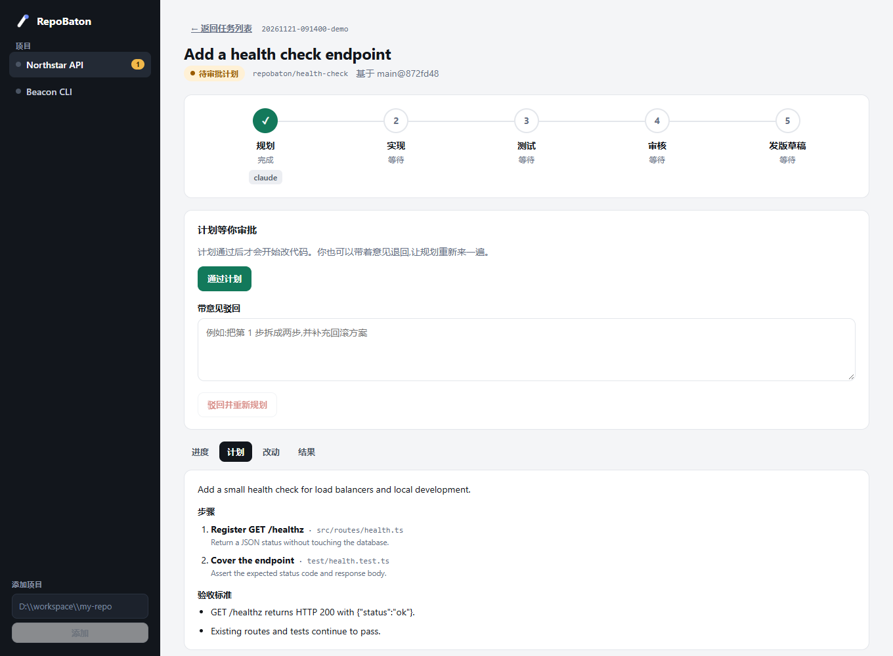
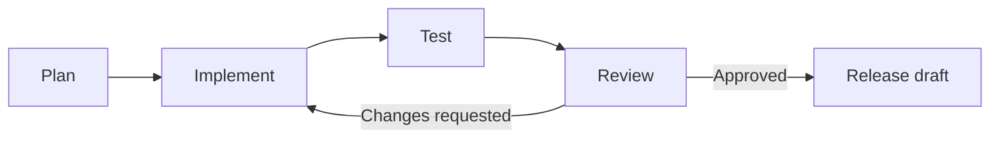

<h1 align="center">RepoBaton</h1>

<p align="center"><strong>Local workflows for Codex, Claude Code, and compatible agents</strong></p>

<p align="center">Coordinate local agents on your projects.<br>Choose the steps, handoffs, and workflow from your browser.</p>

<p align="center">
  <a href="https://github.com/SunwardL/RepoBaton/releases/latest"></a>
  
  
</p>

<p align="center">
  <a href="#quick-start">Quick start</a> &middot;
  <a href="#how-it-works">Workflow</a> &middot;
  <a href="#configuration">Configuration</a> &middot;
  <a href="#recovery">Recovery</a>
</p>

<p align="center">
  
  <br><sub>The local dashboard with an example plan ready for approval.</sub>
</p>

## Quick start

You need **Node.js 22.18+** and Git to clone this repository. The built-in workflow requires a Git project with at least one commit; a custom workflow also works in an ordinary local folder. Configure locally authenticated Claude Code and Codex CLIs, or [configure API agents or another CLI](#configuration).

```shell
git clone https://github.com/SunwardL/RepoBaton.git
cd RepoBaton
npm ci
npm run install:web
npm run build
node bin/repobaton.mjs ui
```

Add your project from the sidebar, then create a task. You can also add a project when starting the server:

```shell
node bin/repobaton.mjs ui --project ../your-project --port 8787
```

The server listens on `127.0.0.1`. The command prints a launch URL with a token generated for that server session. Use that full URL if the page asks you to reopen it. Add `--no-open` to skip opening the browser automatically.

<details>
<summary><strong>Run from the terminal</strong></summary>

Run these commands from the RepoBaton checkout, substituting your project path:

```shell
node bin/repobaton.mjs doctor --repo ../your-project
node bin/repobaton.mjs init --repo ../your-project
node bin/repobaton.mjs run "Add a health check endpoint" --repo ../your-project --approve-plan -v
```

`init` writes a starter `repobaton.yaml` into the project. The CLI can also approve or reject a pending plan, follow a run live, and print its Markdown report. See `node bin/repobaton.mjs help` for the full command list.

</details>

## How it works



| Stage | What happens |
| --- | --- |
| **Plan** | Turn the task into steps and acceptance criteria. With plan approval enabled, approve the specific plan you reviewed or send feedback for a revision. |
| **Implement** | Edit in a dedicated Git worktree and record a commit for the round. |
| **Test and review** | Run the project's test command, then review the commit in a fresh session. By default, failed tests and blocking findings require another round. |
| **Release draft** | Collect the approved change, a suggested version, PR text, and release notes. Remote publish steps are opt-in. |

The dashboard remembers projects and shows progress, diffs, and reports. Each Git repository can run one task at a time, including its linked worktrees. Separate projects can run at the same time. When a project is busy, the dashboard asks you to try again after the active run stops.

For a custom workflow, choose **自定义流程** when creating a task. Add and reorder agent, command, human confirmation, or Git commit steps; choose agents and write their prompts. Add the task, previous outputs, or workspace files as inputs so each agent receives the intended handoff. YAML import and export are optional. Before starting, review the steps and commands in the confirmation panel.

The run page can show a redacted, size-limited record of the prompt actually sent to an agent. Each agent still manages its own native conversation; this record does not include its earlier native context.

In a Git project with commits, custom steps share a dedicated worktree. You can leave changes uncommitted, add an explicit commit step, or ask an agent to manage Git. In an ordinary folder or a repository without commits, custom steps work directly in the selected folder, so edits affect those files immediately. Git and publishing are not required for a custom workflow.

Custom workflows can optionally push, open or merge a PR, and tag a release. Add a commit step and a final approval step; the approval shows the exact commit, destination, and publication details. If a remote operation is interrupted, check its result before continuing. Push and recovery have been exercised with local Git remotes; PR, merge, and tag operations have been tested with substitutes, not a live GitHub repository.

## Configuration

Open **全局 Agent** in the sidebar to check local Codex and Claude Code sign-in status, add an API connection (**添加 API**), or configure a non-interactive executable (**添加命令**). The form saves to per-user `agents.json`. Supply API keys through environment variables. If you have an existing YAML config, **从 YAML 导入** loads its `agents` into the form for review before saving.

Use a project's **配置** page to set stage defaults and edit any custom command already defined in that project's YAML. When creating a task, choose an Agent and model for each stage to override those defaults for that task. RepoBaton keeps the task's choices through approval and resume. Implementer retries can continue the original CLI session for that task. Planning and each review round use separate sessions (see Native sessions). For example, enable plan approval and keep the default Claude Code and Codex split:

```yaml
stages:
  plan:
    agent: claude
    requireApproval: true
  implement:
    agent: codex
  review:
    agent: claude
```

| Agent type | Connection |
| --- | --- |
| `claude-cli`, `codex-cli` | Use each CLI's local login. |
| `openai-compatible` | Use a Chat Completions endpoint with `baseUrl`, `model`, and `apiKeyEnv`. |
| `anthropic-compatible` | Use a Messages endpoint with `baseUrl`, `model`, and `apiKeyEnv`. |
| `command` | Use a configured command that accepts a prompt and returns a result. |

Set API keys in the environment **before** starting RepoBaton. If a key is missing, the dashboard shows the agent and environment variable name. For example, in Windows Command Prompt:

```cmd
set OPENAI_API_KEY=your-key-here
node bin\repobaton.mjs ui
```

<details>
<summary><strong>CLI paths, test commands, and storage</strong></summary>

- Claude Code and Codex are resolved from `agents.<id>.path`, `REPOBATON_CLAUDE_PATH` or `REPOBATON_CODEX_PATH`, `PATH`, then known install locations. An invalid explicit path is reported immediately.
- Set `test.command` or `test.setup` to override detection. Use `loop.maxReviewRounds`, `loop.blockOn`, and `loop.testsMustPass` to tune the review loop.
- The project list lives in a per-user data directory, `%APPDATA%\repobaton` on Windows by default. Set `REPOBATON_HOME` to change it.
- `.repobaton/runs/<run-id>/` in each project holds the run state, event log, report, and artifacts. The default worktree directory is `.repobaton/worktrees/`.

</details>

## Native sessions

Every stage call (plan, implement, review, release draft) is recorded in the run with its agent, session id, working directory and status. Codex and Claude Code stage sessions are kept on disk. Open a task and look at the native sessions card: it shows each stage, with buttons to copy the session id and a resume command that starts in the recorded worktree.

- Implementer retries continue the same implement session. Each review round keeps its own session.
- Agents that report no session id (API and command agents) show their RepoBaton events and results only, with no native session entry.
- Runs saved before this feature show that the native session cannot be located. Their details and artifacts stay available.

Verified on Windows with Codex CLI 0.171.0-alpha.13 and Claude Code 2.1.319: a session created by RepoBaton resumes by id (`codex exec resume <id>`, `claude --resume <id>`) from its recorded worktree and remembers the earlier work. Codex records the working directory in its session file under `~/.codex/sessions`, and Claude Code stores sessions under `~/.claude/projects`. A test CLI session could not be located in the Codex desktop conversation list; use the recorded ID and CLI resume command to continue it. This observation does not establish how every desktop version or project displays CLI sessions.

## Recovery

If the local server can confirm that it previously owned a run and its owner process is gone, it shows the run as **Interrupted**. Choose **Continue** to pick up from a saved checkpoint. If a commit already passed review, recovery carries that SHA into the remaining steps. Cleanup removes the selected worktree and keeps its branch and commits. Use the UI or the standalone CLI to manage a given run.

Custom steps interrupted while running are marked **result unknown** and are not rerun automatically. A commit step can be recognized as complete only when its recorded parent and tree match and Git has no unfinished operation or index lock. Inspect the workspace and any external side effects before explicitly retrying. Cleanup refuses to discard uncommitted files without a current preview and confirmation; a task using the original project folder cannot remove that folder through cleanup.

You can take over a paused task in the native workspace and return it to RepoBaton. Use **打开工作区** in the task details to open its recorded folder in Windows File Explorer, or copy the path to use another tool. The built-in workflow pauses if the task worktree is on a different branch. Human commits are tested and reviewed again before the built-in workflow proceeds.

<details>
<summary><strong>Recover an interrupted push, PR, merge, or tag</strong></summary>

Use **Check the remote** in the dashboard or `repobaton check <run>` in the CLI. Recovery checks the original push destination and, for PR steps, the recorded GitHub repository. A changed destination or a conflicting result keeps the run paused. When a lookup cannot settle the outcome, the check may accept matching evidence such as a commit SHA or PR URL. Older records without a stored destination require evidence.

Remote publishing requires one push address per remote. PR operations require `github.com` and an authenticated `gh`. Tags point to a merge commit verified on the base branch at the push destination. GitHub publishing stays off unless you enable it in the project configuration or pass explicit publishing flags to the CLI.

</details>

## Development

```shell
npm ci
npm run install:web
npm run typecheck
npm test
npm run build
```

The CLI and local server live in `src/`. The React dashboard lives in `web/`, and the build copies its assets into `dist/web`.
